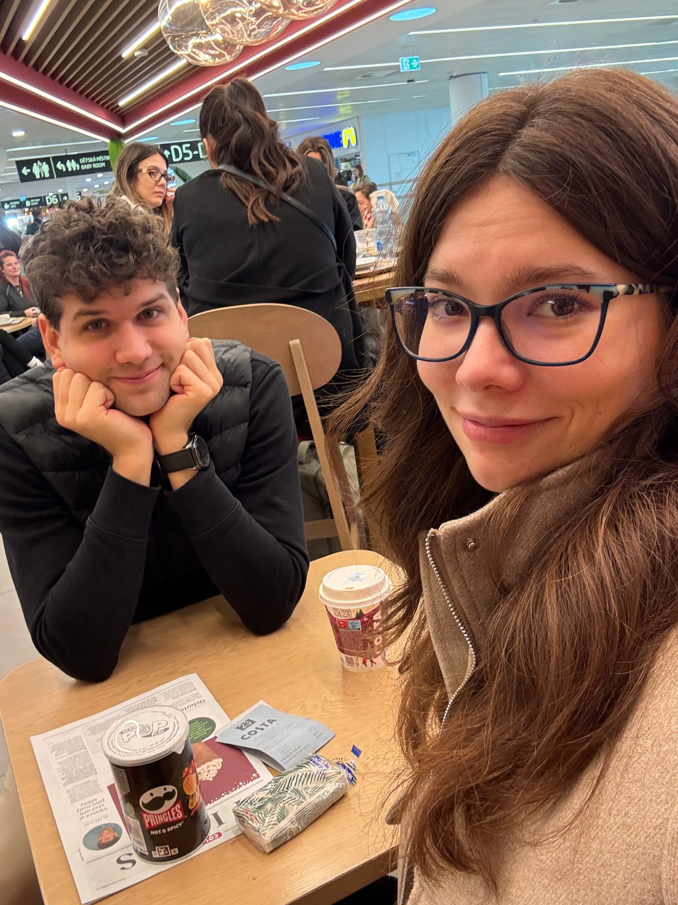
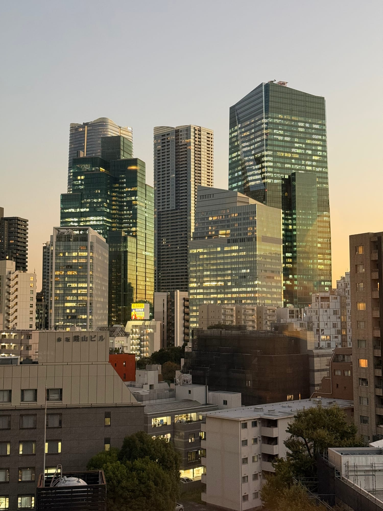
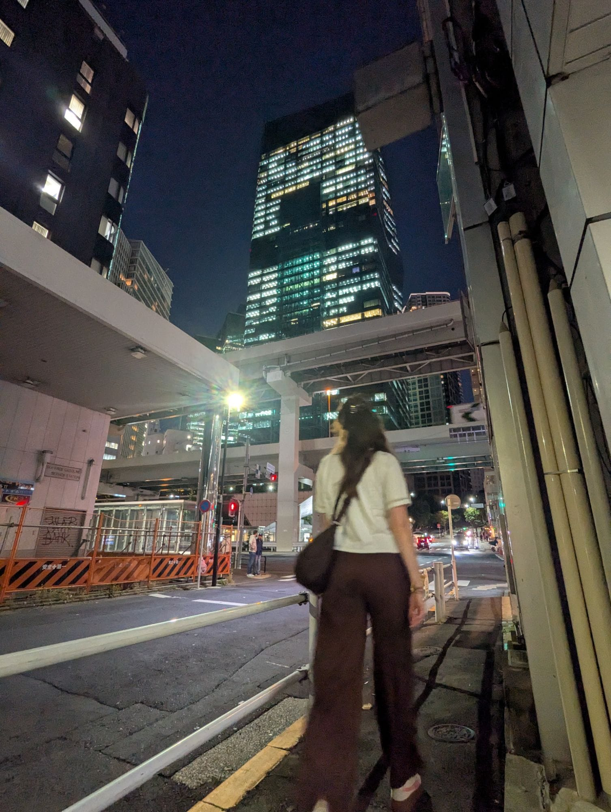
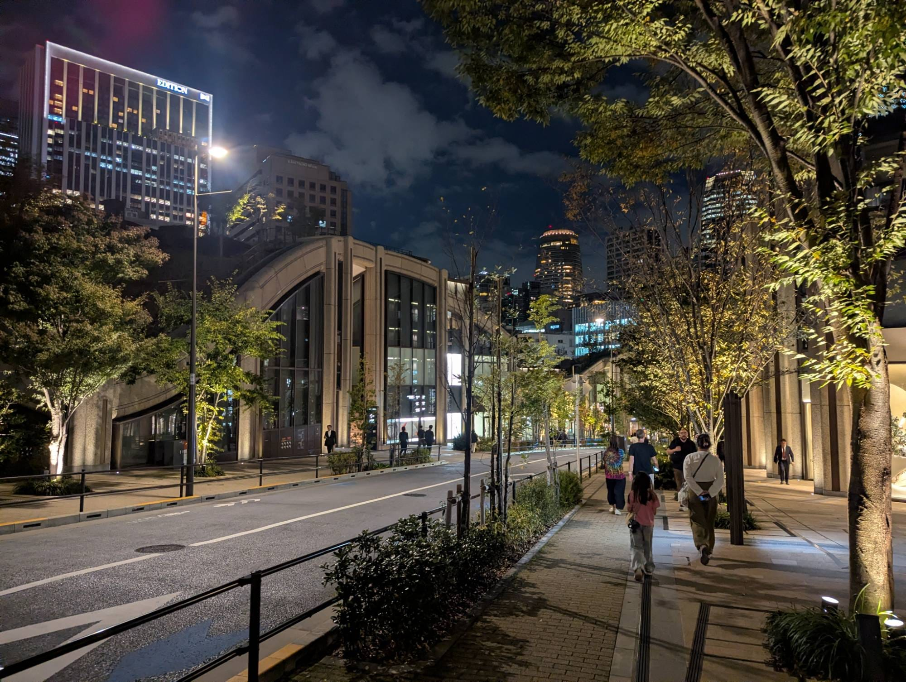
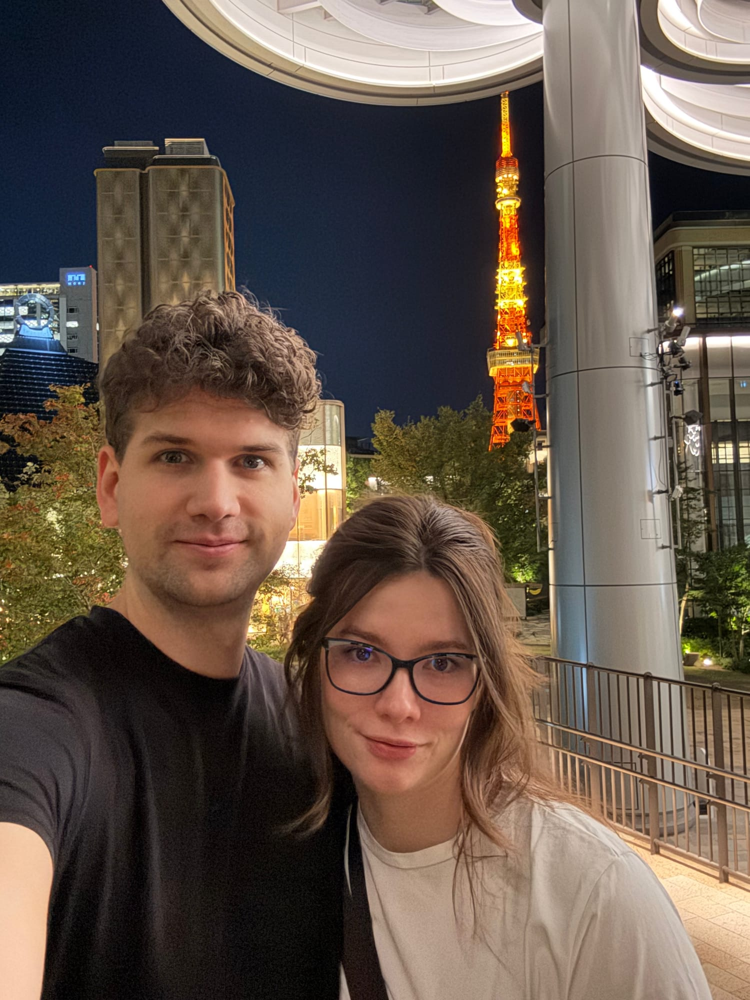
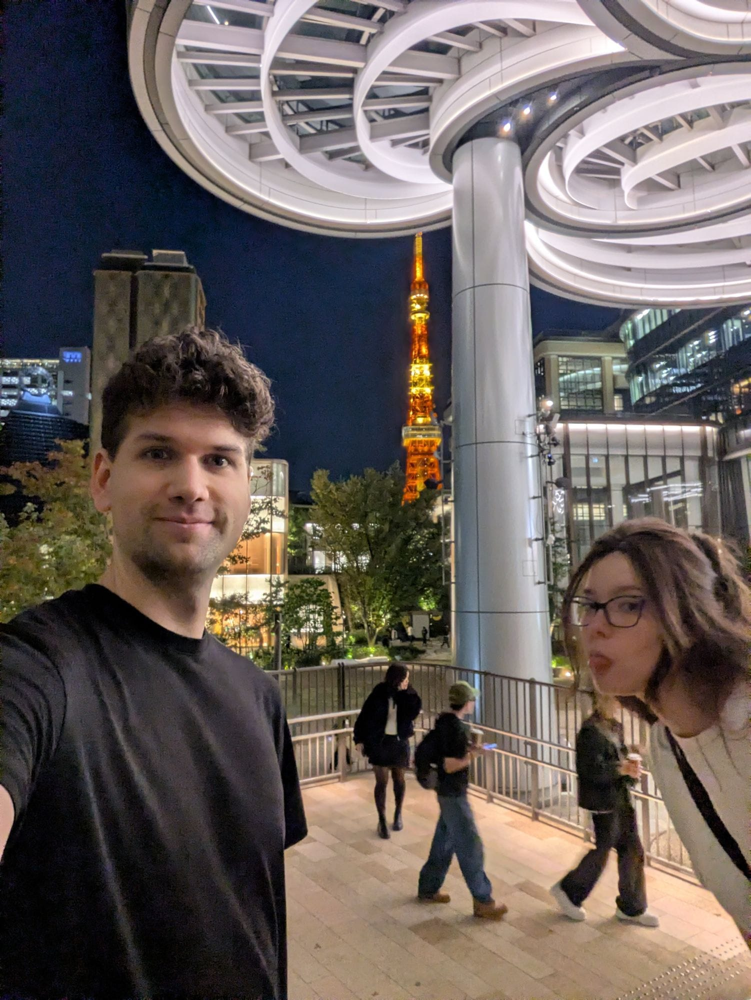

Odlet z Prahy byl bez sebemenších chyb. Ráno jsme si dali kafíčko, počkali na to, než se otevře brána k našemu letu, a pokračovali jsme do Curychu. Barborce patří obrovská pochvala za to, že si sbalila kufr vážící pouze 9,8 kg! Cestuje se s ním mnohem lépe než s tím 23kg slonem minulý rok.

Už při letu z Prahy jsem narazil na skvělou inovaci! V letadle se rozdávaly lahve s vodou, kde šlo – podržte se – oddělit víčko od lahve, aniž by to člověk rval jako blázen.

Curych má hezké letiště, při příletu bylo krásně vidět, jak město sedí na pláni, zatímco v dáli jsou vidět počátky Alp. Na frontu ke vstupu do letadla jsme vyzráli klasicky čecháčkovsky – ve chvíli, kdy se otevřela druhá polovina kiosku pro všechny cestující, a nejen pro premium, obešli jsme celou frontu a na jeden zátah prošli až dovnitř. Nejsme si jistí, že je čím se chlubit, ale každopádně to bylo efektivní.

Při odletu se odehrálo ještě krátké drama. Jsme všichni posazeni v letadle, pásy zapnuté, polštářky všichni připravené – ale nikam se nejede. Po nějaké době čekání se z repráku ozývá, že Lufthansa má nějaký celosvětový IT problém, že se omlouvají, nevědí, jak dlouho to bude trvat, a že zatím startovat nemůžeme. Štěstěna však byla na naší straně. Za dalších 5 minut se ozvalo, že našli záložní řešení a že vyrážíme, zapínejte pásy!

U Švýcarských aerolinek není překvapení, že servis a catering byl skvělý. Pořád někdo chodil s pitím, jako předkrm jsme dostali kostičky parmazánu, jídlo včetně dezertu bylo skvělé a pro cestující zvláště trpící nespavostí rozdávali uprostřed noci i mističky vanilkové zmrzliny. Barborka si je moc užila.

Po příletu jsme – jako minule – strávili hodinu a půl, než jsme vybloudili přes pasové kontroly ven z přepravního prostoru, pořídili dobíjecí kartu na transport a zorientovali se, kudy se máme vydat. Našli jsme expres vlak do města! Tam píšu i tyhle řádky. Máme vybraný cíl – ramen v restauraci na vlakovém nádraží hned vedle našeho hotelu.

Oběd byl velký úspěch. Seděli jsme v malé restauraci, kde jsme dostali na namletí vlastní misku sezamu, která skvěle šla k hustému krémovému vývaru s mletým masem a nudlemi. Paní z obsluhy nám ani nedala moc šanci vyzkoušet si objednávání v japonštině. Místo toho viděla dva cizáky, rovnou přehodila do angličtiny a vytáhla anglická menu. Ostatně to se pak opakovalo po zbytek dne, vždy se na nás obrátili už přímo s angličtinou. Jsou tu na turisty nějak víc zvyklí.

Večer jsme si udělali skvělou procházku přes čtvrť Roppongi.

Zabrouzdali jsme na Azabudai Hills, což je architektonicky velice zajímavý development s domy, které se často táhnou jako kopce od země do výšky a pak zase zpět. Všude je to mezi moderními budovami zalité spoustou vody, stromů a zeleně.

Zabrouzdali jsme i kolem věže Tokyo Tower, ale zůstali jsme pouze u výhledu na ni, a ne z ní. Nahoru se nám lézt nechtělo, i přesto, že se tam člověk spíš vyveze výtahem. Zakotvili jsme tak místo toho v přilehlém parku, kde byl výhled na světle červenou věž mezi korunami stromů celkem úchvatný.

[Naše večerní trasa na mapě](https://maps.app.goo.gl/1SyTMkbgpiVwmjyw5)
