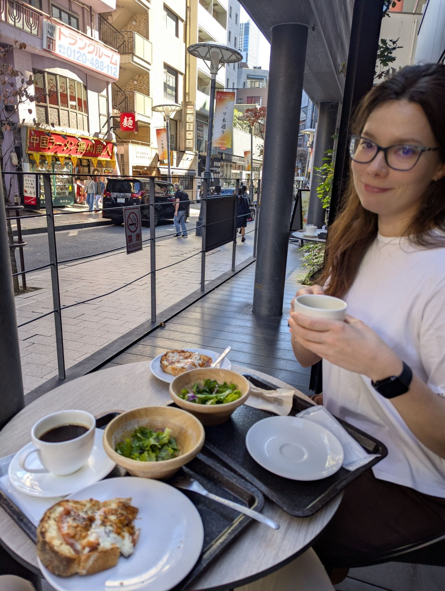
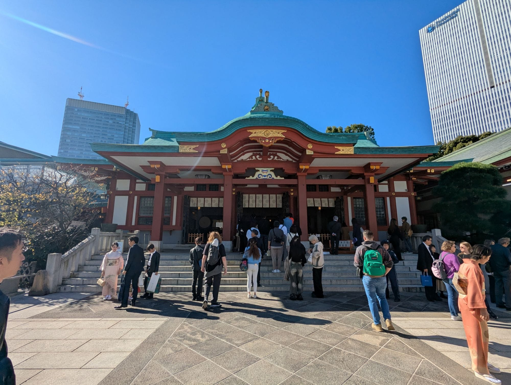
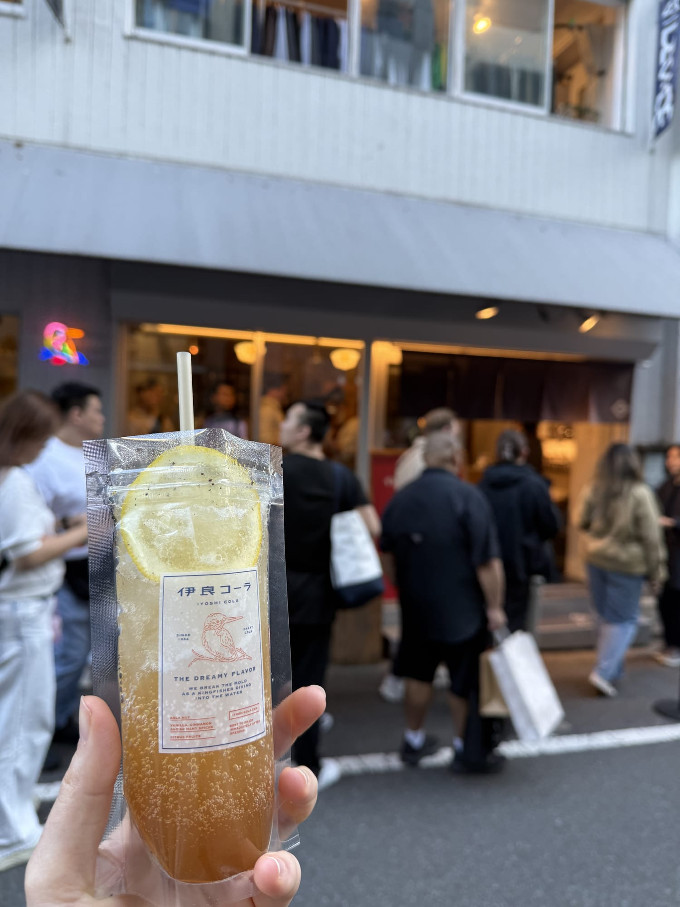
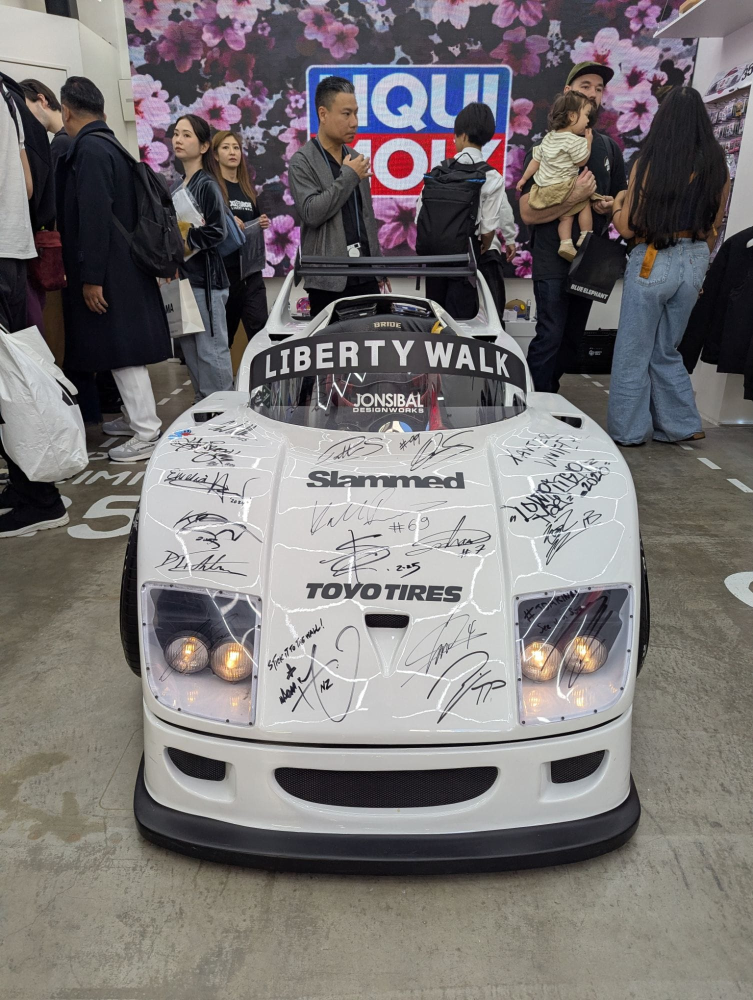
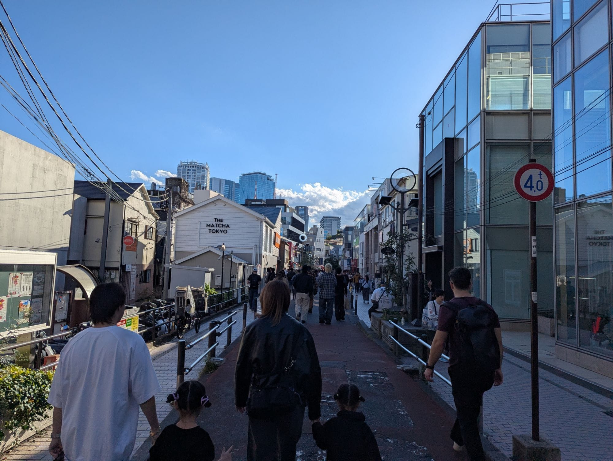
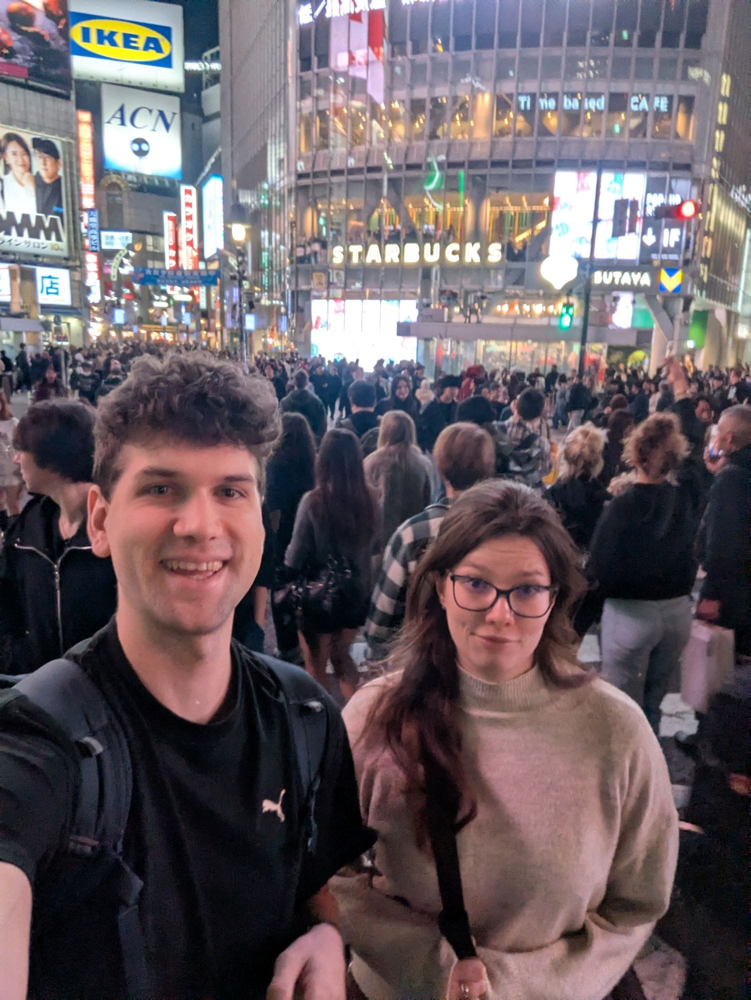
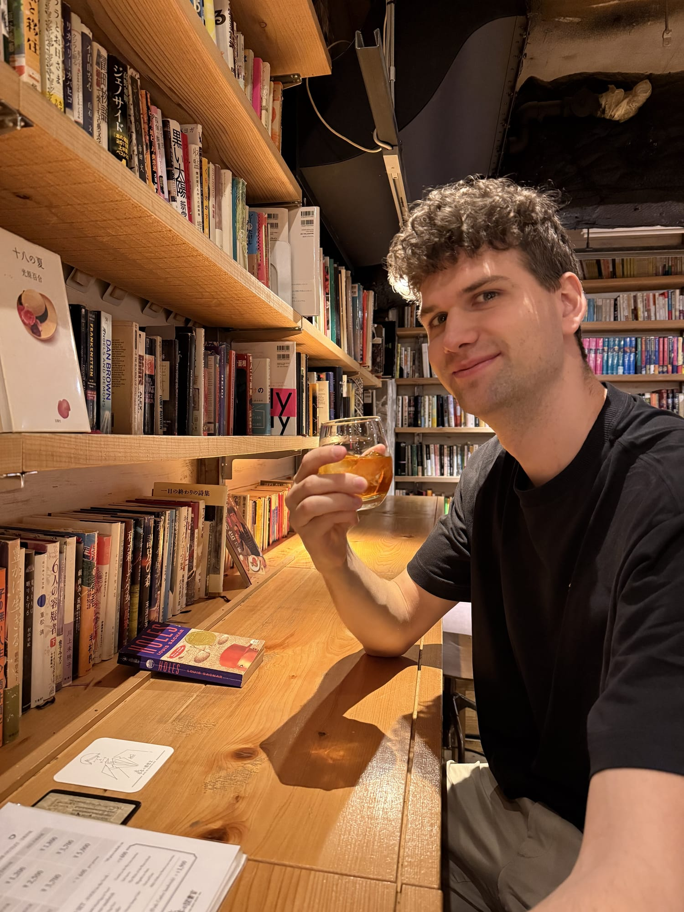
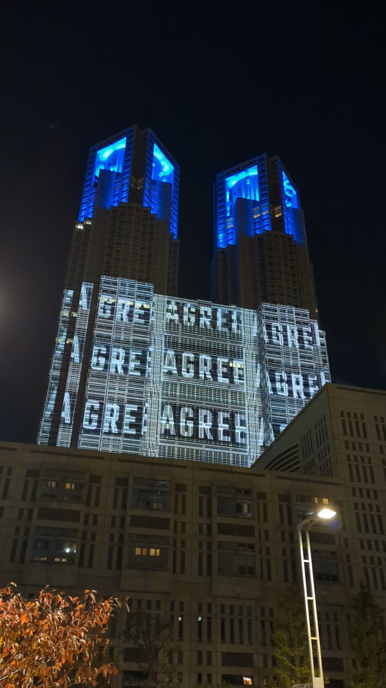

Den začínáme jak jinak než skvělou kávou se zapečeným sýrovým toustem – z toho se tu pro nás stala už celkem tradice.

Sedíme před polednem na verandě kavárny a pozorujeme ulici, kde se to hemží lidmi, a já u toho přemýšlím, jak dobře mají na takové obrovské město nadesignované ulice. Mimo hlavní tepny města jsou ulice tak široké, že se na nich sotva vyhne jedno auto druhému stojícímu, a zbytek prostoru dávají všem ostatním. Chodci jdoucí mezi kavárnami, prací a jinými povinnostmi se vyhýbají cyklistům, taxíkům a mini náklaďáčkům zavážejícím zboží a celé to působí tak nějak komponovaně, hezky, lidsky a příjemně.

Ještě než se dostáváme do metra, odbočujeme na svatyni Hie, kde se zrovna mezi běžnými návštěvníky odehrává i svatební focení. V těch kimonech jim to vážně slušelo!

Pak už vyrážíme na naši pěší tour městem. Dostáváme se přes Omotesando k Liberty Walk Tokyo na Cat Street.

Pěší nákupní ulice je super, jsou tu obchody snad všech světových značek, ale i těch menších lokálních. Občas zalezeme i dovnitř, abychom se podívali.

Po cestě objevujeme i Iyoshi Colu, která se stále vyrábí z bylinek podle originálního receptu už snad přes 70 let.

Tím se dostáváme do středu čtvrti Shibuya, kde z výšin nákupního domu koukáme na slavný přechod pod námi a bavíme se tím, jak se pokaždé nahrne dav turistů doprostřed a ti nejodvážnější z nich se nehnou ze středu svých objektivů, dokud se přímo proti nim nevyřítí další vlna aut. I my jsme si ho samozřejmě museli projít.

<video controls muted playsinline preload="none" width="720" height="1280" poster="/posts/den-2/shibuya-prechod.jpg" aria-label="Noční přechod v Shibuyi shora: davy lidí zaplaví křižovatku, pak se rozejdou a projedou auta">
	<source src="/posts/den-2/shibuya-prechod.mp4" type="video/mp4" />
</video>

Hned o ulici dál na nás ale čekal jeden z nejklidnějších a nejhezčích zážitků. Existuje tam totiž takový celkem neoznačený podnik, kde když vyjedete do osmého patra a cinknete na ten správný zvonek, otevře se polička s knihami a za ní se ukrývá knižní kavárna. Tady jsme si sedli, dali si čaj a na nějakou hodinku si odpočinuli při listování těmi pár anglickými knížkami, co jsme našli.

Za tmy se ještě přesouváme do Shinjuku. Nutně jsem ještě potřeboval na vyhlídku z budovy místní radnice. Na budovu se periodicky dělá i videomapping, což nám dost dobře napovědělo, kam jít. Poté jsme se nechali vyvézt do 45. patra a shlédli jsme na celé Tokio kolem dokola.

