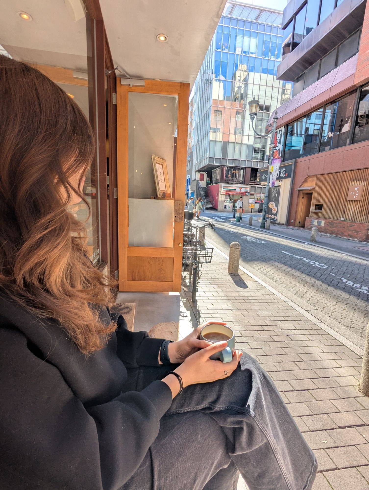
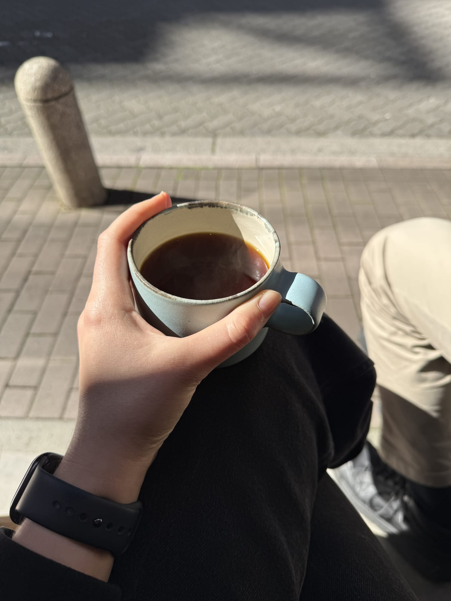
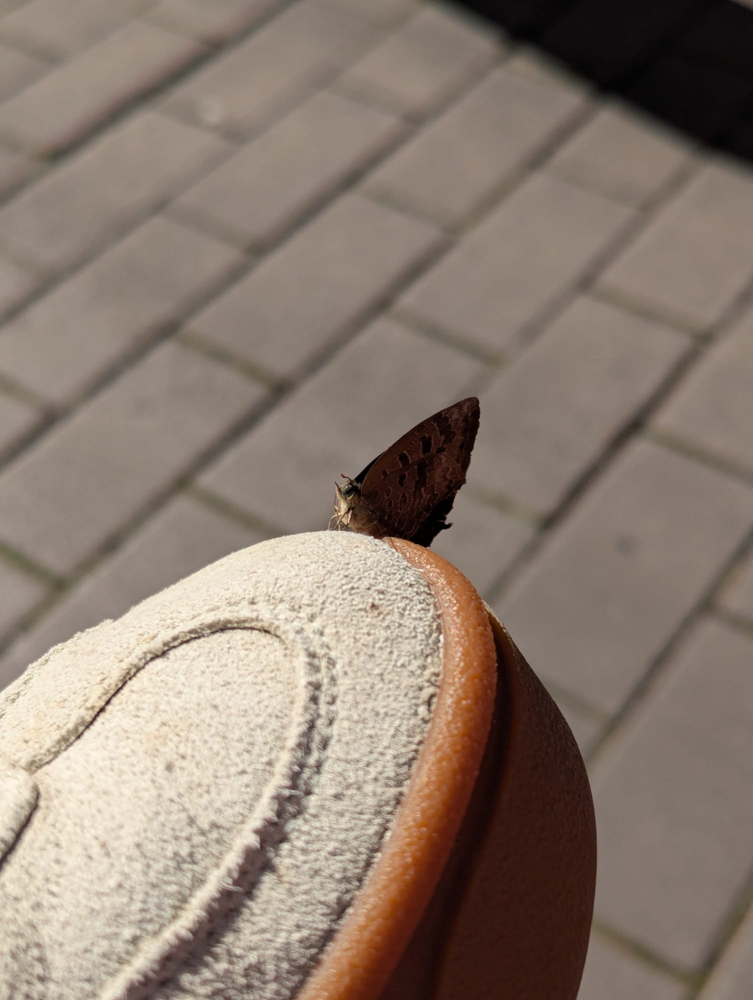
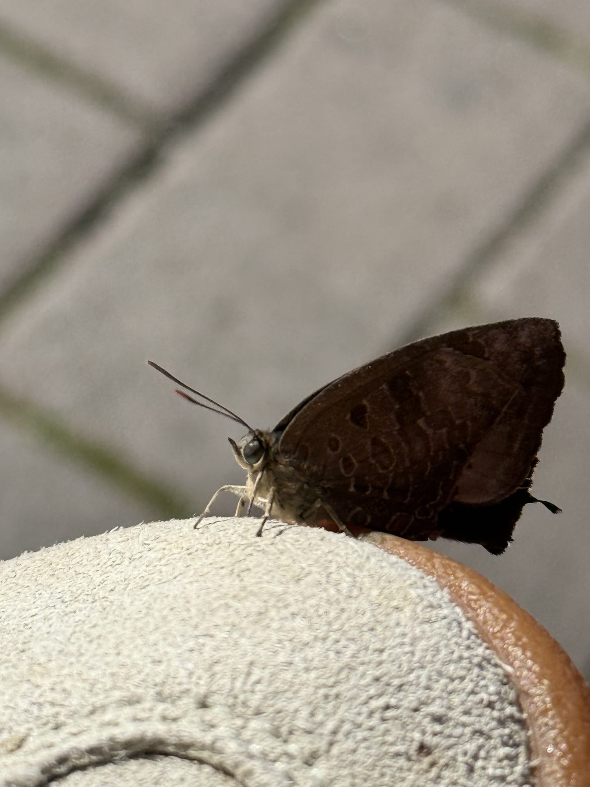
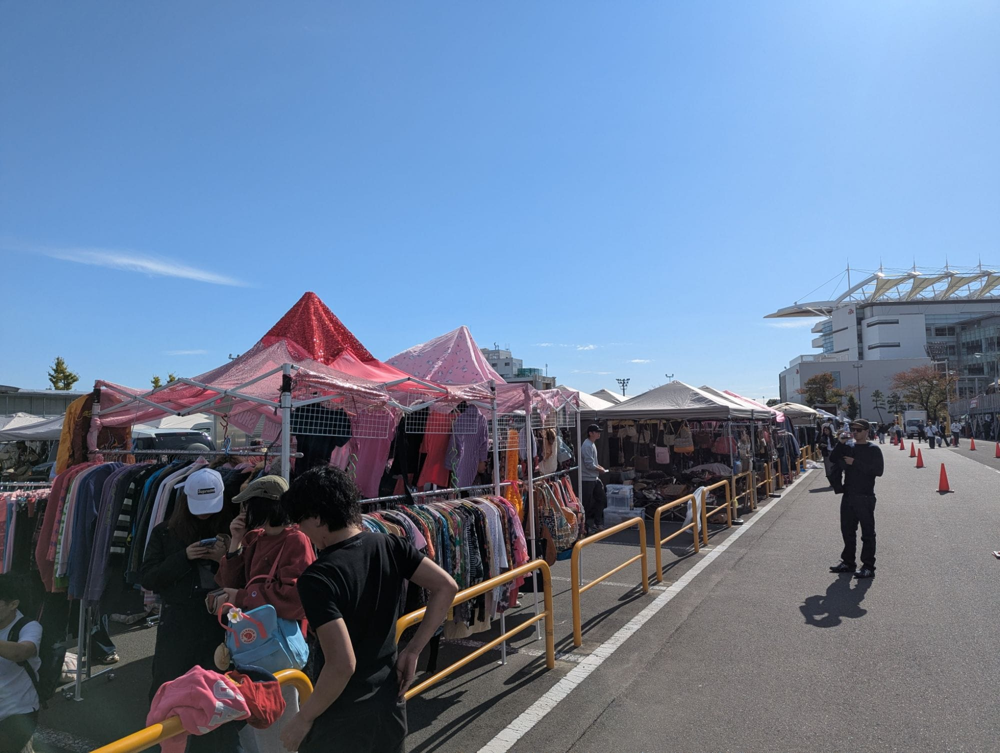
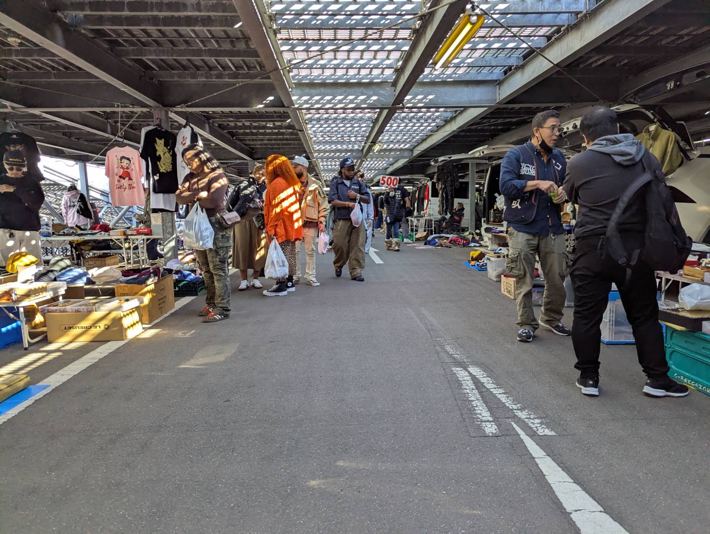
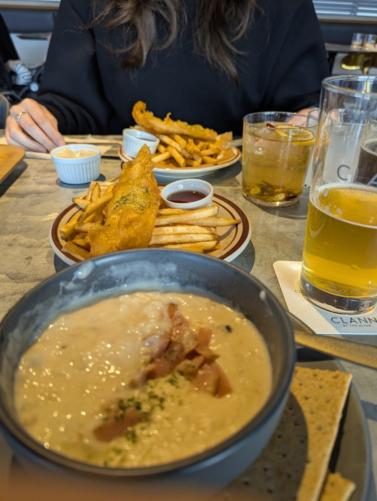
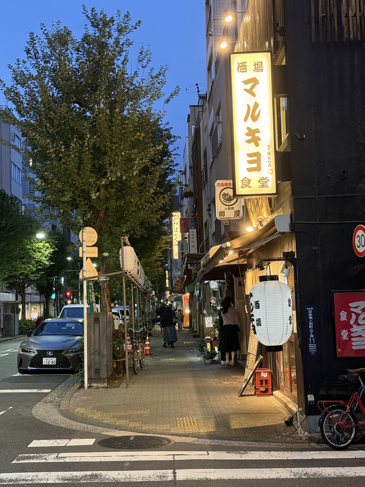
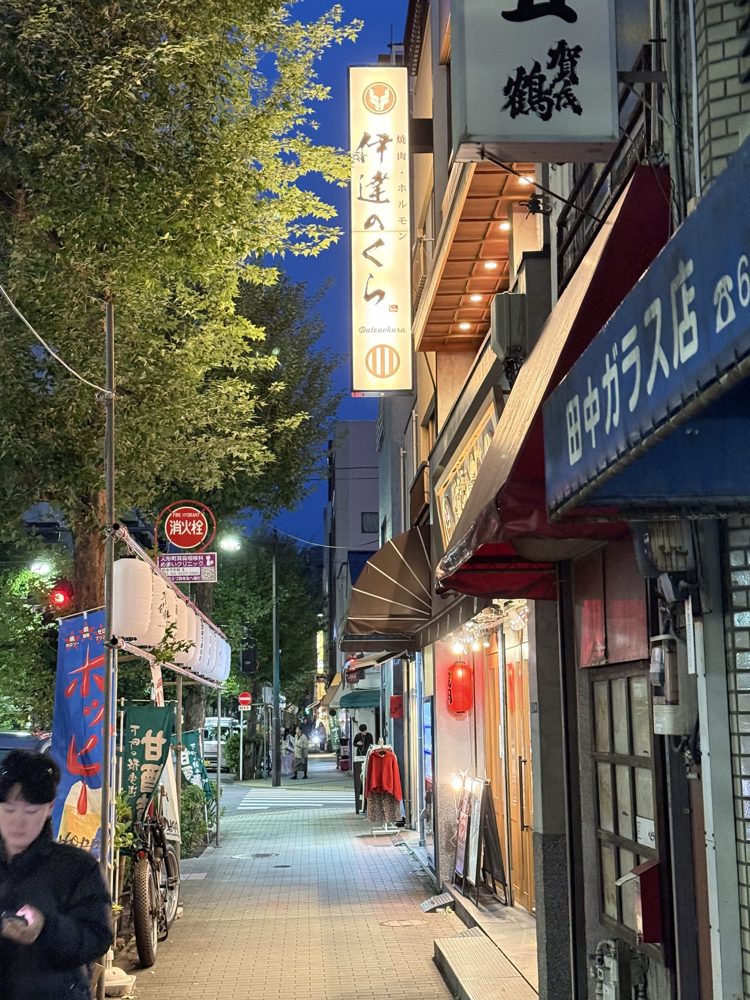
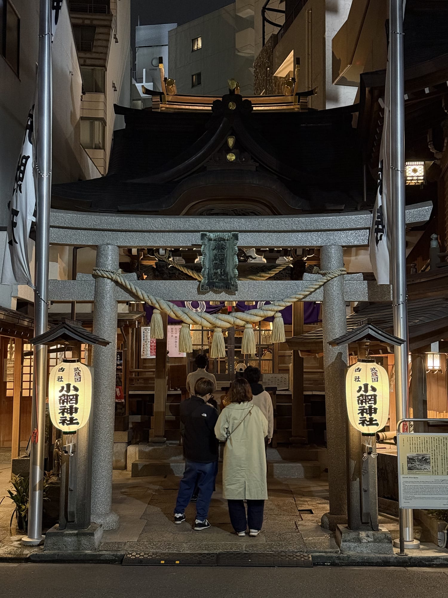

Den znovu začínáme skvělým kafem a sýrovým toustem. Tentokrát v kavárně Tokyo Little House, dvě uličky od místa, kde jsme seděli včera na snídani. Znovu sedíme venku, i když tentokrát jen na malé lavičce před obchodem. Krásně na nás svítí sluníčko, je něco málo pod 20 stupňů, a tak se nahříváme na zbytek dne.

Z hotelu jsme se předtím už odhlásili, kufr máme s sebou, a tak po dobré snídani klesáme pod zem na metro a jedeme na jih města. K mému překvapení v jednu chvíli přestupujeme na jednokolejku, která nás po vyvýšené betonové konstrukci veze nad ulicemi města i ostatními vlaky až do doků. Tam se jdeme podívat na obrovský bleší trh, který se právě o víkendu koná. Po cestě jsme potkali hrozně roztomilého robota, který nás pronásledoval až k eskalátoru a dokud jsme mu nezmizeli z očí, na nás stále mával.

Naprostou většinu zboží tady tvoří vintage oblečení, hodinky a elektronika. Carhartt, Patagonia, staré Nike a Adidas bundy a svetry z 90. let. Spousta značkových kabelek, batohů a tašek. Sem tam se objeví i nějaký stánek s cetkami nebo LP a CD.

Pak se odebíráme zahodit náš otravný kufr do dalšího hotelu a projít se po nové čtvrti.

Jelikož jsme ještě neměli oběd a já mám obrovskou chuť na nějaké pivo, míříme směrem k řece, kde už mám předvybraný podnik – malý pivovar a skandinávsky vypadající restauraci v jednom. Fronta je úmorně dlouhá, ale to je tu většinou známka toho, že je o co stát.

Jelikož je to moderní restaurace západního typu, na menu je fish & chips (smažená ryba a hranolky) a clam chowder (nevím, jak to nazvat česky – asi mušlový krém?). K tomu gin tonic z japonského ginu, limonáda z místního bylinkového sirupu a koření a taky pivo – jedno Scotch ale, které chutná asi jako Guinness, a druhé plzeňského typu, které chutná tak trochu divně, stejně jako dánská piva, co znám :)

Po skvělém obědě se už jenom jdeme toulat uličkami kolem. Střídají se nákupní uličky s malými chrámy, malými obchůdky a krásnými hotely.

Celkem brzy ale míříme zpět, jelikož nás tlačí potřeba doplánovat střípky cesty na dalších pár dní a na konec našeho pobytu. Večeře ze sámošky, kde se jídlo zpravidla každý den brzy ráno připravuje úplně čerstvé, byla taky dost dobrá!
